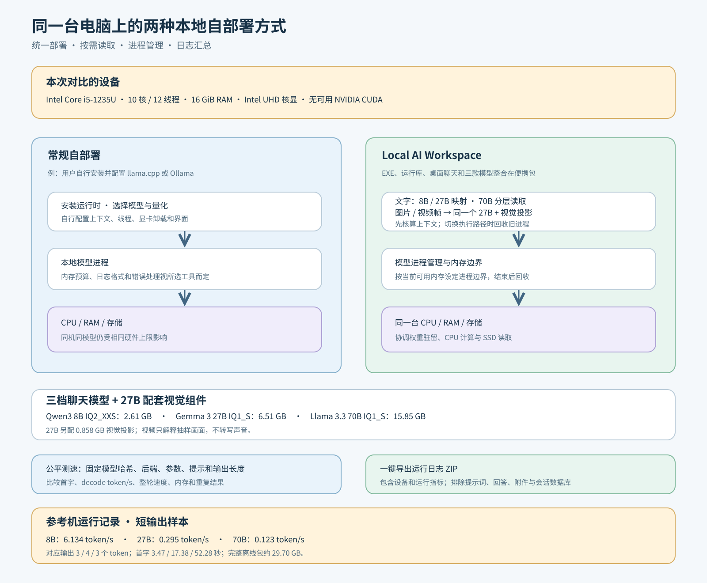

# 低配置电脑上的大参数模型运行

**Local AI Workspace｜Windows 本地 AI 工作区**

Local AI Workspace 面向普通 Windows 电脑，将 8B、27B、70B 模型、推理环境和桌面操作整合为完整离线应用。作品围绕一个问题展开：在内存有限、没有独立显卡的设备上，怎样安排大模型的存储、读取与计算？

## 设计出发点

参考电脑使用 Intel Core i5-1235U、16 GiB 内存和 Intel UHD 核显。70B 低比特权重仍约 14.77 GiB，Windows、应用、上下文缓存与计算缓冲也需要内存。设计重点因此落在减少权重同时驻留的数量，并管理模型从启动到退出的完整过程。

## 核心原理

**低比特量化：缩小权重表示。** 采用固定版本的 GGUF 量化文件，三个聊天模型与视觉组件合计约 25.82 GB，连同应用和运行环境构成约 29.70 GB 的离线包。量化用较少比特记录权重，在存储开销与数值精度之间进行取舍。

**按需读取：安排有限内存。** 8B 与 27B 使用内存映射访问权重；70B 使用分层 CPU 读取，将当前计算需要的权重调入内存，再推进后续计算。可以把 SSD 理解为书库、内存理解为工作桌：书保存在书库中，桌面安排当前正在处理的内容。减少驻留会增加读取与等待，SSD 速度和内存余量因此直接影响体验。

**进程管理：控制启动、切换与回收。** 应用根据可用内存和用户设置安排模型进程。70B 驻留配置上限为 4 GiB，默认模型进程提交上限为 12 GiB；两项均为运行参数。文字预设最多 4 个线程、2048 token 上下文、每轮 256 个新 token。模型切换、取消和退出由应用统一回收子进程。

## 自主实现与技术贡献

- **桌面交互：** 聊天、历史会话、附件输入与 Python 工作区。
- **模型配置：** 固定三档模型，登记版本、文件大小和 SHA256。
- **运行调度：** 连接内存映射、分层读取与文字/视觉执行路径。
- **生命周期管理：** 资源预算、模型切换、请求取消和进程回收。
- **测量与统计：** 统一性能字段，导出跨设备运行日志 ZIP。
- **离线集成：** 将模型、运行库和界面组织为解压即可使用的环境。

基础模型来自 Qwen、Google Gemma 与 Meta Llama；量化文件采用 Unsloth 发布版本，推理引擎基于 llama.cpp 等上游组件。作品的创新重点是围绕低配置设备，将资源管理、操作流程和性能测量连接成一套可复现的应用方案。

## 同一台电脑上的部署方式对比

| 对比项 | 自行组合部署工具 | Local AI Workspace |
| --- | --- | --- |
| 环境准备 | 选择后端、模型、运行库和界面 | 离线包内置环境与三档模型 |
| 参数设置 | 分别设置线程、上下文、量化与卸载方式 | 提供固定模型配置与资源预算 |
| 大模型读取 | 根据所选工具配置 | 8B/27B 内存映射，70B 分层 CPU 读取 |
| 操作流程 | 随工具组合而变化 | 聊天、历史、附件、取消和切换集中操作 |
| 运行记录 | 各工具使用各自的日志格式 | 统一记录首字时长、token/s、内存和结束状态 |
| 多机统计 | 手动整理不同格式的数据 | 导出 CSV、JSONL，按设备与模型分组 |

区别集中在部署、资源管理和统计流程。速度对照需要固定权重、后端版本、上下文、线程、输入和输出长度，在相近系统负载下测量。

## 三档模型与运行结果

| 模型 | 量化 | 权重体积 | 使用定位 |
| --- | --- | ---: | --- |
| Qwen3 8B | UD-IQ2_XXS | 2.61 GB | 轻量文字交互 |
| Gemma 3 27B | UD-IQ1_S | 6.51 GB | 文字与图片输入 |
| Llama 3.3 70B | UD-IQ1_S | 15.85 GB | 大参数模型本地运行探索 |

参考机离线短回答记录：

| 模型 | 输出 token 数 | 解码 token/s | 首字时长（秒） |
| --- | ---: | ---: | ---: |
| 8B | 3 | 6.134 | 3.47 |
| 27B | 4 | 0.295 | 17.38 |
| 70B | 3 | 0.123 | 52.28 |

以上为短输出样本。持续生成、多任务质量和同机配对对照是后续测量内容；性能优化目标为 27B 4 token/s、70B 0.5 token/s。

## 图片与视频帧处理

Gemma 3 27B 配套约 0.86 GB 的视觉组件，将图像转换为模型可处理的表示。图片先规范化；视频通过 FFmpeg 抽取最多 6 帧，连同采样时刻进入同一 27B 模型。该路径处理抽样画面，不转写音频。

视觉请求使用 8 线程、256-token batch/microbatch 的 CPU 配置，以适配图像块；文字与视觉切换时回收旧进程。两张简单图片测试通过，两次视频测试的回答完整性仍需改进。

## 运行日志与跨设备统计

点击“导出运行日志 ZIP”即可获得 `runs.csv`、`runs.jsonl` 与字段说明。日志包含软件版本、CPU/内存、模型哈希、量化、运行模式、token 数、首字时长、模型就绪时间、解码速度、内存和结束状态；聊天正文与附件保留在本机，不进入统计包。

统计时按模型哈希、量化、软件版本和文字/视觉模式分组，分别比较启动等待、生成速度与资源占用。这样能将不同电脑上的运行情况转化为可复测的数据，为后续优化提供依据。

## 应用价值

作品将低配置设备上的大模型运行变成可操作、可观察的过程：用固定配置降低部署门槛，用资源管理协调有限内存，用统一日志积累真实运行数据，服务本地 AI 学习、技术展示与跨设备实验。
