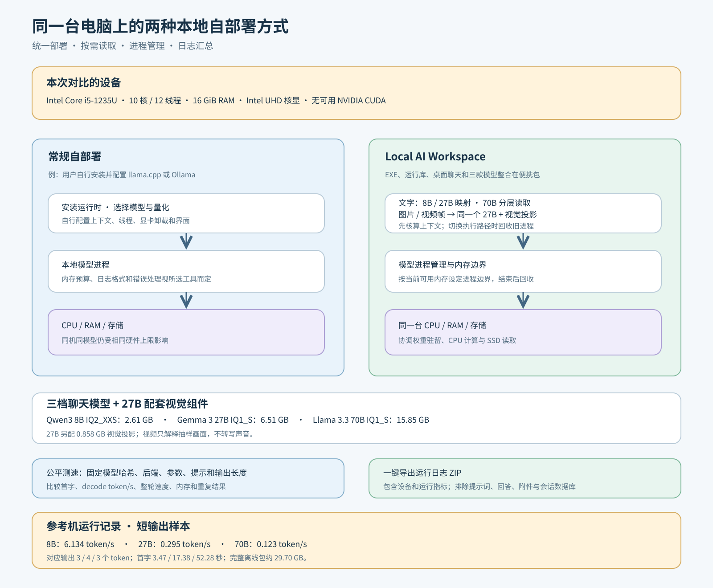

# Local AI Workspace 使用指南

Windows 本地 AI 工作区，预置 Qwen3 8B、Gemma 3 27B、Llama 3.3 70B，支持文字、图片与视频抽样帧输入。

## 三步开始

1. 将完整压缩包解压到空间充足的 SSD 目录。
2. 双击 LocalAIWorkspace.exe，在模型选择器中选择 8B、27B 或 70B。
3. 输入问题并发送；生成过程中可查看运行状态或取消。

应用、运行库和模型文件需要保持原有目录结构。

## 选择模型

| 模型 | 权重体积 | 运行方式 | 使用定位 |
| --- | ---: | --- | --- |
| Qwen3 8B | 2.61 GB | CPU 内存映射 | 轻量文字交互 |
| Gemma 3 27B | 6.51 GB | CPU 内存映射 | 文字与图片输入 |
| Llama 3.3 70B | 15.85 GB | 分层 CPU 读取 | 大参数模型本地实验 |

图片与视频帧会使用 27B 及其视觉组件。视频最多抽取 6 帧，不转写音频；当前视频回答完整性仍需改进。

## 低内存运行

模型文件保存在 SSD。8B/27B 按需映射，70B 按层读取并计算，以安排权重驻留。70B 驻留配置上限为 4 GiB，默认模型进程提交上限为 12 GiB。可用内存、磁盘速度、上下文长度和后台负载会影响等待时间。

应用在启动前核算资源，切换或取消时回收模型进程。资源不足时，根据界面提示减少上下文或附件，或释放内存后重试。

## 参考机短输出记录

设备：Intel Core i5-1235U、16 GiB RAM、Intel UHD 核显。

| 模型 | 输出 token 数 | 解码 token/s | 首字秒 |
| --- | ---: | ---: | ---: |
| 8B | 3 | 6.134 | 3.47 |
| 27B | 4 | 0.295 | 17.38 |
| 70B | 3 | 0.123 | 52.28 |

## 导出运行日志

在“设置与工具”点击“导出运行日志 ZIP”。包内包含 runs.csv、runs.jsonl 和字段说明，用于汇总设备、模型版本、首字时长、加载时间、token/s、内存和结束状态。

首字时长表示从请求到首次返回的等待；解码 token/s 表示文本片段的生成速度。比较不同电脑时，保持模型文件、量化、线程、上下文和测试内容一致。日志包不包含聊天正文与附件。

## 运行结构

依赖许可见 docs/LICENSES.md。
